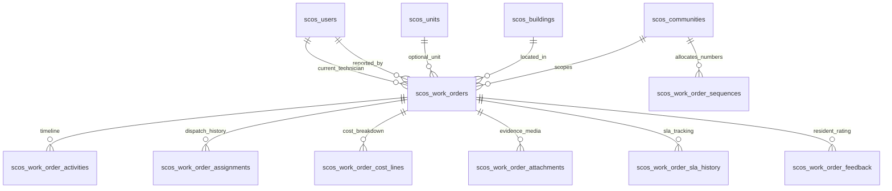
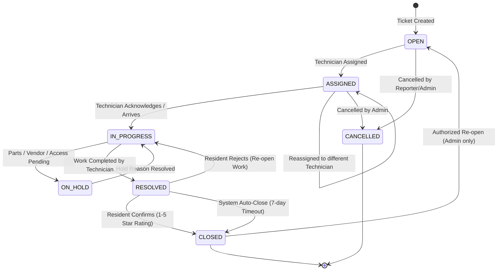

# SCOS Complaint & Maintenance Tracking Subsystem (Work Orders Desk)
## Comprehensive Technical Design Specification

- **Module Name**: `com.scos.modules.maintenance`
- **Pillar**: Pillar 2 — Community Operations
- **Reference Implementation**: SCOS Kernel-Enabled Domain Service
- **Status**: FROZEN / APPROVED DESIGN
- **Date**: 2026-10-15

---

## 1. System Overview & Objectives

The **Work Orders Desk** is the operational backbone for smart community maintenance in SCOS. It provides an enterprise-grade service management workflow covering both private residential units and estate-wide common infrastructure.

### Core Objectives
1. **Multi-Tenant Isolation**: Strictly partition all work orders, sequences, assignments, and costs by `communityId`.
2. **State Machine Integrity**: Enforce deterministic, server-side status transitions with optimistic locking (`@Version`) preventing race conditions and stale overwrites.
3. **Configurable SLA Engine**: Calculate authoritative response and resolution deadlines on the server in UTC, with 24/7 elapsed time for critical emergencies and pause/resume tracking during holds.
4. **Append-Only Timeline & Audit**: Separate business operational history (`scos_work_order_activities`) from platform security audit logging (`scos_audit_logs`).
5. **Itemized Financial Ledger**: Record labor, parts, materials, and contractor expenses using `NUMERIC(12,2)` with currency definitions, laying the groundwork for Pillar 3 (Finance & Maintenance Billing).
6. **Dual-Mode Operations UI**: Deliver an Angular 18 operations command center offering fluid switching between a Kanban board and a data table, powered by a slide-over workbench drawer.

---

## 2. Complete Domain & Database Model

### 2.1 Entity Relationship Diagram



### 2.2 Table Definitions

#### 1. `scos_work_orders` (Core Ticket Record)
| Column | Type | Constraints | Description |
| :--- | :--- | :--- | :--- |
| `id` | `UUID` | `PRIMARY KEY` | Unique work order ID |
| `community_id` | `UUID` | `NOT NULL, FK -> scos_communities(id)` | Tenant partition |
| `ticket_number` | `VARCHAR(32)` | `NOT NULL` | Human-readable ID (e.g. `WO-2026-0001`) |
| `title` | `VARCHAR(160)` | `NOT NULL` | Issue summary headline |
| `description` | `TEXT` | `NOT NULL` | Comprehensive problem description |
| `scope` | `VARCHAR(20)` | `NOT NULL, CHECK (scope IN ('PRIVATE_UNIT', 'COMMON_AREA'))` | Issue physical scope |
| `building_id` | `UUID` | `NULL, FK -> scos_buildings(id)` | Associated building/tower |
| `unit_id` | `UUID` | `NULL, FK -> scos_units(id)` | Required if scope is `PRIVATE_UNIT` |
| `location_details` | `VARCHAR(200)` | `NULL` | Precise location (e.g. "Clubhouse 2nd Floor") |
| `category` | `VARCHAR(40)` | `NOT NULL` | `PLUMBING`, `ELECTRICAL`, `HVAC`, `ELEVATOR`, `CIVIL`, `SECURITY_DEVICE`, `GARDENING`, `OTHER` |
| `priority` | `VARCHAR(20)` | `NOT NULL, CHECK (priority IN ('CRITICAL', 'HIGH', 'MEDIUM', 'LOW'))` | Urgency tier |
| `status` | `VARCHAR(30)` | `NOT NULL` | `OPEN`, `ASSIGNED`, `IN_PROGRESS`, `ON_HOLD`, `RESOLVED`, `CLOSED`, `CANCELLED` |
| `reported_by_user_id` | `UUID` | `NOT NULL, FK -> scos_users(id)` | User who filed the issue |
| `assigned_technician_id` | `UUID` | `NULL, FK -> scos_users(id)` | Current assigned technician |
| `sla_policy_version` | `VARCHAR(20)` | `NOT NULL DEFAULT 'v1'` | Version of SLA applied |
| `sla_due_at` | `TIMESTAMPTZ` | `NOT NULL` | Authoritative target resolution time |
| `sla_breached` | `BOOLEAN` | `NOT NULL DEFAULT FALSE` | Flag for SLA breach |
| `total_cost` | `NUMERIC(12,2)` | `NOT NULL DEFAULT 0.00` | Aggregated monetary expense |
| `currency_code` | `VARCHAR(3)` | `NOT NULL DEFAULT 'INR'` | ISO 4217 Currency |
| `version` | `BIGINT` | `NOT NULL DEFAULT 0` | Optimistic locking version |
| `created_by` | `VARCHAR(60)` | `NOT NULL` | Auditing author |
| `created_at` | `TIMESTAMPTZ` | `NOT NULL DEFAULT CURRENT_TIMESTAMP` | UTC creation timestamp |
| `updated_by` | `VARCHAR(60)` | `NOT NULL` | Auditing last updater |
| `updated_at` | `TIMESTAMPTZ` | `NOT NULL DEFAULT CURRENT_TIMESTAMP` | UTC update timestamp |

**Unique Constraint**: `UNIQUE (community_id, ticket_number)`
**Index**: `idx_wo_community_status (community_id, status)`, `idx_wo_sla (community_id, sla_due_at, sla_breached)`

#### 2. `scos_work_order_sequences` (Concurrency-Safe Counter)
| Column | Type | Constraints | Description |
| :--- | :--- | :--- | :--- |
| `community_id` | `UUID` | `NOT NULL, FK -> scos_communities(id)` | Tenant scope |
| `year` | `INT` | `NOT NULL` | Sequence calendar year |
| `current_sequence` | `BIGINT` | `NOT NULL DEFAULT 0` | Monotonically increasing counter |

**Primary Key**: `(community_id, year)`

#### 3. `scos_work_order_activities` (Append-Only Business Timeline)
| Column | Type | Constraints | Description |
| :--- | :--- | :--- | :--- |
| `id` | `UUID` | `PRIMARY KEY` | Activity event ID |
| `work_order_id` | `UUID` | `NOT NULL, FK -> scos_work_orders(id)` | Target ticket |
| `author_user_id` | `UUID` | `NOT NULL, FK -> scos_users(id)` | Author of action |
| `activity_type` | `VARCHAR(40)` | `NOT NULL` | `STATUS_TRANSITION`, `ASSIGNMENT`, `NOTE_ADDED`, `HOLD_PLACED`, `HOLD_RESUMED`, `COST_RECORDED`, `VERIFIED_CLOSED` |
| `from_status` | `VARCHAR(30)` | `NULL` | Previous state |
| `to_status` | `VARCHAR(30)` | `NULL` | New state |
| `notes` | `TEXT` | `NOT NULL` | Context or comment |
| `created_at` | `TIMESTAMPTZ` | `NOT NULL DEFAULT CURRENT_TIMESTAMP` | Action timestamp (UTC) |

#### 4. `scos_work_order_assignments` (Technician History)
| Column | Type | Constraints | Description |
| :--- | :--- | :--- | :--- |
| `id` | `UUID` | `PRIMARY KEY` | Assignment ID |
| `work_order_id` | `UUID` | `NOT NULL, FK -> scos_work_orders(id)` | Target ticket |
| `technician_id` | `UUID` | `NOT NULL, FK -> scos_users(id)` | Technician assigned |
| `assigned_by_user_id`| `UUID` | `NOT NULL, FK -> scos_users(id)` | Supervisor/Manager |
| `assigned_at` | `TIMESTAMPTZ` | `NOT NULL DEFAULT CURRENT_TIMESTAMP` | Assignment time |
| `notes` | `VARCHAR(255)` | `NULL` | Dispatch instructions |

#### 5. `scos_work_order_cost_lines` (Financial Line Items)
| Column | Type | Constraints | Description |
| :--- | :--- | :--- | :--- |
| `id` | `UUID` | `PRIMARY KEY` | Line item ID |
| `work_order_id` | `UUID` | `NOT NULL, FK -> scos_work_orders(id)` | Target ticket |
| `cost_type` | `VARCHAR(30)` | `NOT NULL, CHECK (cost_type IN ('LABOR', 'MATERIALS', 'VENDOR_FEE', 'EQUIPMENT', 'OTHER'))` | Item category |
| `item_description` | `VARCHAR(160)` | `NOT NULL` | Description of parts/labor |
| `quantity` | `NUMERIC(10,2)` | `NOT NULL DEFAULT 1.00` | Units or hours |
| `unit_price` | `NUMERIC(12,2)` | `NOT NULL` | Rate per unit |
| `total_amount` | `NUMERIC(12,2)` | `NOT NULL` | `quantity * unit_price` |
| `currency_code` | `VARCHAR(3)` | `NOT NULL DEFAULT 'INR'` | Currency |
| `recorded_by_user_id`| `UUID` | `NOT NULL, FK -> scos_users(id)` | Staff member |
| `created_at` | `TIMESTAMPTZ` | `NOT NULL DEFAULT CURRENT_TIMESTAMP` | Entry timestamp |

#### 6. `scos_work_order_feedback` (Resident Verification & Rating)
| Column | Type | Constraints | Description |
| :--- | :--- | :--- | :--- |
| `id` | `UUID` | `PRIMARY KEY` | Feedback record ID |
| `work_order_id` | `UUID` | `NOT NULL, UNIQUE, FK -> scos_work_orders(id)` | 1-to-1 with ticket |
| `resident_user_id` | `UUID` | `NOT NULL, FK -> scos_users(id)` | Resident verifying |
| `rating` | `INT` | `NOT NULL, CHECK (rating BETWEEN 1 AND 5)` | Star rating |
| `feedback_comments`| `TEXT` | `NULL` | Quality notes |
| `resolution_confirmed`| `BOOLEAN` | `NOT NULL` | True if verified resolved |
| `is_auto_closed` | `BOOLEAN` | `NOT NULL DEFAULT FALSE` | True if timed out by system |
| `created_at` | `TIMESTAMPTZ` | `NOT NULL DEFAULT CURRENT_TIMESTAMP` | Rating timestamp |

---

## 3. State Machine & Transition Rules



### Transition Authority Matrix
| From State | Allowed To State | Authorized Roles | Mandatory Requirements |
| :--- | :--- | :--- | :--- |
| `OPEN` | `ASSIGNED` | `SUPER_ADMIN`, `COMMUNITY_MANAGER`, `HOA_OFFICER` | Valid `technicianId` |
| `OPEN` | `CANCELLED` | `SUPER_ADMIN`, `COMMUNITY_MANAGER`, `OWNER`, `TENANT` (if reporter) | Cancellation reason note |
| `ASSIGNED` | `IN_PROGRESS` | `TECHNICIAN` (assignee), `SUPER_ADMIN`, `COMMUNITY_MANAGER` | Dispatch acknowledge note |
| `ASSIGNED` | `ASSIGNED` | `SUPER_ADMIN`, `COMMUNITY_MANAGER` | New technician ID + reassignment note |
| `IN_PROGRESS` | `ON_HOLD` | `TECHNICIAN`, `SUPER_ADMIN`, `COMMUNITY_MANAGER` | Hold category (`AWAITING_PARTS`, `RESIDENT_UNAVAILABLE`, `VENDOR_DISPATCH`) + details |
| `ON_HOLD` | `IN_PROGRESS` | `TECHNICIAN`, `SUPER_ADMIN`, `COMMUNITY_MANAGER` | Resume explanation |
| `IN_PROGRESS` | `RESOLVED` | `TECHNICIAN`, `SUPER_ADMIN`, `COMMUNITY_MANAGER` | Resolution summary note + itemized costs |
| `RESOLVED` | `CLOSED` | `OWNER`, `TENANT` (reporter), `SUPER_ADMIN`, `COMMUNITY_MANAGER` | 1 to 5 star rating (or auto-close flag) |
| `RESOLVED` | `IN_PROGRESS` | `OWNER`, `TENANT` (reporter), `SUPER_ADMIN` | Rejection feedback explanation |
| `CLOSED` | `OPEN` | `SUPER_ADMIN`, `COMMUNITY_MANAGER` | Supervisor authorization note |

---

## 4. Configurable SLA Engine

### Default Target Parameters
* `CRITICAL`: 4 Elapsed Hours (Calculated 24/7/365, emergency escalation).
* `HIGH`: 12 Business Hours (08:00 to 20:00 active window).
* `MEDIUM`: 24 Business Hours.
* `LOW`: 48 Business Hours.

### Operational Hold Rules
1. When a ticket transitions to `ON_HOLD`, the SLA countdown is suspended.
2. The remaining duration ($T_{remaining} = T_{sla\_due} - T_{hold\_start}$) is recorded in `scos_work_order_sla_history`.
3. When the hold is resumed back to `IN_PROGRESS`, the new target deadline is recalculated as $T_{sla\_due\_new} = T_{resume} + T_{remaining}$.
4. All pause and resume events are permanently logged.

---

## 5. REST API Architecture (`/api/v1/work-orders`)

### 1. File New Work Order
`POST /api/v1/work-orders`
```json
{
  "communityId": "ce5abdcd-ab83-4cbc-92f7-aa689c7b2797",
  "title": "Main Water Line Pressure Drop",
  "description": "Pressure drop observed on 12th floor Tower A.",
  "scope": "COMMON_AREA",
  "buildingId": "3fa85f64-5717-4562-b3fc-2c963f66afa6",
  "unitId": null,
  "locationDetails": "Tower A Utility Shaft",
  "category": "PLUMBING",
  "priority": "HIGH"
}
```

### 2. Query Work Orders
`GET /api/v1/work-orders?communityId={id}&status={status}&priority={priority}&scope={scope}&page=0&size=20&search={q}`
Returns: `ApiResponse<PageResponse<WorkOrderDto>>`

### 3. Metric KPI Overview
`GET /api/v1/work-orders/summary?communityId={id}`
Returns:
```json
{
  "totalActive": 18,
  "openCount": 5,
  "assignedCount": 4,
  "inProgressCount": 6,
  "onHoldCount": 3,
  "resolvedCount": 24,
  "slaBreachedCount": 1,
  "averageRating": 4.8
}
```

### 4. Assign Technician
`PATCH /api/v1/work-orders/{id}/assign`
```json
{
  "technicianId": "c825dc53-9aa2-425d-b927-9a6028dfb9c4",
  "notes": "Please carry replacement 1-inch brass valves."
}
```

### 5. Transition State
`PATCH /api/v1/work-orders/{id}/status`
```json
{
  "targetStatus": "IN_PROGRESS",
  "notes": "Technician on site at Tower A shaft."
}
```

### 6. Record Cost Line
`POST /api/v1/work-orders/{id}/costs`
```json
{
  "costType": "MATERIALS",
  "itemDescription": "Heavy Duty Brass Valve 1-inch",
  "quantity": 2,
  "unitPrice": 450.00,
  "currencyCode": "INR"
}
```

### 7. Resident Verification & Star Rating
`POST /api/v1/work-orders/{id}/feedback`
```json
{
  "rating": 5,
  "resolutionConfirmed": true,
  "feedbackComments": "Prompt resolution and clean workmanship."
}
```

---

## 6. Frontend Operations Command Center (`src/app/features/work-orders`)

### Key Components
1. **`WorkOrderListComponent`**: Main shell housing KPI metrics cards, search toolbar, and tab toggling between:
   - **Kanban Board View**: Column lanes (`OPEN`, `ASSIGNED`, `IN_PROGRESS`, `RESOLVED`, `CLOSED`) with draggable cards, urgency pulse dots, and dynamic countdown timers.
   - **Data Table View**: Dense operational table with sorting, pagination, and multi-filter criteria.
2. **`WorkOrderWorkbenchDrawerComponent`**: Slide-over panel maintaining list context while exposing:
   - Header with status badge, priority chip, and SLA status indicator.
   - Action toolbar displaying only permissible transitions based on current state and user role.
   - Technician dispatch picker.
   - Tabbed detail sections: Overview, Itemized Costs, and Timeline Audit.
   - Resident star rating widget with feedback input.
3. **`CreateWorkOrderModalComponent`**: Accessible dialog validating private unit selection vs common areas, auto-fetching active community buildings and units.
4. **Sidebar Navigation**: Integrated into `SidebarComponent` under `COMMUNITY OPERATIONS` with icon `🛠️` and screen guard `SCREEN:WORK_ORDERS`.

---

## 7. Delivery Plan (6-Stage Execution)

1. **Stage 1 (Complete)**: Technical Specification Freeze & Architecture Review.
2. **Stage 2**: Database schema migration (`V5__init_work_orders_and_maintenance_desk.sql`) and domain JPA entities with sequence generator.
3. **Stage 3**: Spring Boot application service, SLA calculation engine, state machine validator, and REST controller endpoints.
4. **Stage 4**: Kernel integration (Multi-tenant scoping, RBAC `SCREEN:WORK_ORDERS`, and business activity audit logging).
5. **Stage 5**: Angular 18 Enterprise UI (Kanban board, data table, slide-over workbench drawer, and modal).
6. **Stage 6**: End-to-end browser automation verification, compilation checks, and recording.
